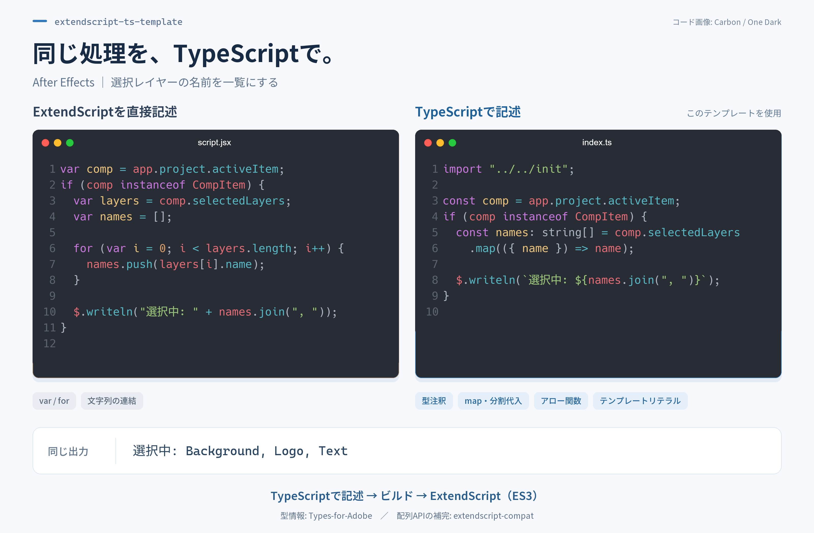
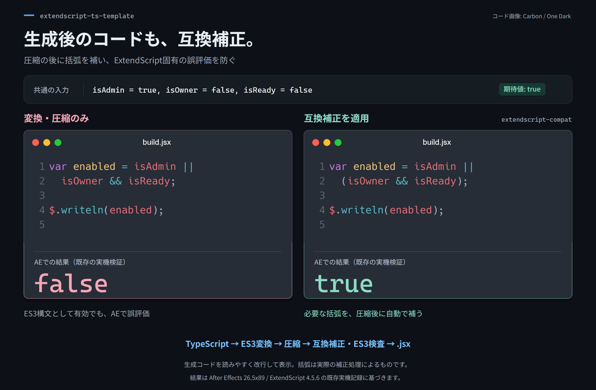

# extendscript-ts-template

複数の Adobe アプリ向け ExtendScript を TypeScript からトランスパイルして管理する軽量モノレポテンプレートです。

[extendscript-compat](https://github.com/YukiWorks432/extendscript-compat)でJSONとES5・ES6の一部を補完し、ExtendScript固有の不具合を補正します。
TypeScriptからExtendScript向けのコードへ変換します。

ExtendScriptの制約により、`Symbol` `Promise`など、一部のライブラリはオミットされています。  
詳細は `docs/polyfills.md` を参照してください。  
補正の詳細と制限は、リンク先の利用文書を参照してください。
ポリフィルの制約に反するコードや ExtendScript 固有の禁止事項は、Oxlint がエラーとして表示します。
コード整形には Oxfmt を使用します。

型情報には[Types-for-Adobe](https://github.com/docsforadobe/Types-for-Adobe)を使用しています。  
これは有志によって作成されたもので、公式の情報ではないため、定義されていない情報がいくつもあります。足りない定義などがあればプルリクエストを検討してください。

## TypeScriptで記述

型情報を使いながら、アロー関数や分割代入、配列メソッドなどでスクリプトを記述できます。
次の図は、選択レイヤー名の一覧を出力する同じ処理を、ExtendScriptの直接記述とTypeScriptで比較した例です。



## 生成コードの互換補正

圧縮後の生成コードに `extendscript-compat` の補正を適用し、最終出力をES3構文として検査します。
次の図は、混在する `&&` と `||` の優先順位を括弧で保護する例です。



図の結果は、After Effects 26.5x89 / ExtendScript 4.5.6の既存実機検証に基づきます。
補正の範囲と制限は[ポリフィル](docs/polyfills.md)を参照してください。

## 公開契約

1.xでは、公開した設定・CLI・ソース配置・共通API・成果物の振る舞いを安定対象にします。内部のビルド方式はこの契約を保って改善します。安定範囲と版番号の判断は[公開契約](docs/public-contract.ja.md)を参照してください。

## 対応アプリ

デフォルトで以下のアプリが設定済みです：

| アプリ        | ID     | ディレクトリ |
| ------------- | ------ | ------------ |
| After Effects | `aeft` | `src/aeft/`  |
| Illustrator   | `ilst` | `src/ilst/`  |
| Photoshop     | `phxs` | `src/phxs/`  |

`pnpm add-app -- --app=<appId>` で新しいアプリを追加できます。
雛形を追加できるアプリIDは `aeft`, `ilst`, `phxs`, `idsn`, `ppro`, `anmt`, `audt` です。
雛形生成への対応と実機での確認範囲は異なります。詳細は[検証記録](docs/validation.md)を参照してください。

## 環境 / Environment

- Node.js `^24.22.1`
- pnpm 12 系（`package.json` の `devEngines.packageManager.version` で `^12.16.1` を指定）
- TypeScript `4.9.5`（ES3 出力のため固定）

TypeScript 4.9.5 を固定する理由と、Babel 8・TypeScript 5 系を別移行とする判断は、
[ADR 0001](docs/adr/0001-typescript-4-9-5-for-es3.md) に記録しています。

## 検証済みの範囲

Windows上のAfter Effects・Illustrator・Photoshop・Premiere Proについて、過去の実機検証記録があります。
製品版、対象コミット、確認項目と制限は[検証環境と実機確認の記録](docs/validation.md)を参照してください。
現在の導入条件は上の「環境」に従います。過去の実機結果と、現在のCIによる検証は対象が異なります。

## インストール / Install

このリポジトリはテンプレートリポジトリです。`Use this template`から自分用のリポジトリを作成してください。
テンプレート利用後は、`AGENTS.md` と `.agents/` を自分の開発環境や運用ルールに合わせて調整して構いません。
リリース workflow や FUNDING などの運営用設定もコピーされるため、不要な設定は削除してください。
初期整理の詳細は [テンプレート利用後の初期整理](docs/template-customization.md) を参照してください。

```bash
pnpm install
pnpm run configure
pnpm new
pnpm typecheck
pnpm build
```

初回設定ではプロジェクト名と使用アプリ、サンプル・AI向け設定の利用を選びます。
変更一覧を確認してから反映します。選択肢とファイルの保護は
[テンプレート利用後の初期設定](docs/template-customization.md)を参照してください。

## 使い方 / Usage

各アプリの `src/{appId}/` 内にスクリプトフォルダと `index.ts` を作成し、
`es.config.mjs` にエントリを登録します。

以下のコマンドで簡単にスクリプトを追加できます：

```shell
pnpm new -- --app=aeft --name=MyScript --license
```

ScriptUI パネル対応スクリプトを作る場合は `--ui=scriptui` を指定します：

```shell
pnpm new -- --app=aeft --name=MyPanel --license --ui=scriptui
```

対話式でも作成できます：

```shell
pnpm new
```

生成される説明コメントの規格と、生成後に `TODO` を完成させる手順は
[スクリプト説明コメントブロック](docs/script-comment-block.md) を参照してください。

### es.config.mjs

```mjs
export default {
  scripts: {
    aeft: [
      {
        name: "example",      // src/aeft/example/index.ts がビルドされます
        version: "0.0.1",
        license: true,         // LICENSE の内容を出力に挿入
      },
    ],
    ilst: [...],
    phxs: [...],
  },
  common: [
    {
      name: "tests",           // src/tests/index.ts がビルドされます
      version: "0.0.1",
      license: true,
    },
  ],
};
```

### スクリプトのテンプレート

```ts
// src/aeft/example/index.ts
/**
 * @script example
 * @app aeft
 * @material-symbols TODO: 公式一覧を確認し、候補を3件カンマ区切りで記載
 * @description
 *   TODO: 対象・操作・得られる結果を1〜3文で記載
 *
 * @workflow
 *   1. TODO: 利用者から見た操作と結果を記載
 */

import "../../init";
import { entry } from "../../lib/lib";

entry("example", () => {
  // TODO: Implement example
});
```

## 型チェック / Type Check

```bash
pnpm typecheck                 # 共通コードと全アプリを型チェック
pnpm typecheck -- --app=aeft  # After Effects だけ型チェック
```

型チェックは TypeScript 4.9.5 で実行し、成果物は生成しません。

## ビルド / Build

```bash
pnpm build          # 変更のあるスクリプトをビルド
pnpm build --all    # 全スクリプトを強制ビルド
pnpm build --app=aeft  # 特定アプリのみビルド
pnpm build:aeft     # After Effects のスクリプトのみビルド
```

出力先は `dist/{appId}/{ScriptName}/` です。

watchもあります。

```bash
pnpm watch
```

## コマンド一覧

| コマンド                | 説明                             |
| ----------------------- | -------------------------------- |
| `pnpm run configure`    | 新しいコピーの初回設定           |
| `pnpm build`            | 変更のあるスクリプトをビルド     |
| `pnpm build --all`      | 全スクリプトを強制ビルド         |
| `pnpm build --app=aeft` | 特定アプリのみビルド             |
| `pnpm build:aeft`       | After Effects のみビルド         |
| `pnpm build:ilst`       | Illustrator のみビルド           |
| `pnpm build:phxs`       | Photoshop のみビルド             |
| `pnpm watch`            | ファイル変更を監視して自動ビルド |
| `pnpm lint`             | Oxlint でコード検査              |
| `pnpm typecheck`        | TypeScript で全体を型チェック    |
| `pnpm fmt`              | Oxfmt でコード整形               |
| `pnpm fmt:check`        | Oxfmt で整形を検査               |
| `pnpm new`              | 新規スクリプト追加               |
| `pnpm add-app`          | 新規アプリ追加                   |
| `pnpm clean`            | ビルドハッシュをクリーンアップ   |
| `pnpm test`             | Node.js 側の回帰テスト           |

`pnpm add-app -- --app=<appId>` で上記のアプリを追加すると、`pnpm build:<appId>` も自動で追加されます。

## テスト / Test

`src/tests/index.ts`にテストを記述しています。
ビルドして実行すればダイアログが表示され、互換補正が想定どおり動いているかを確認できます。

ビルド・型チェック基盤を含む Node.js 側の回帰テストは `pnpm test` で実行できます。

## ドキュメント

- [プロジェクト概要](docs/project-overview.md)
- [スクリプト説明コメントブロック](docs/script-comment-block.md)
- [ポリフィル](docs/polyfills.md)
- [はじめに](docs/guides/getting-started.md)
- [リリース手順](docs/release-process.md)
- [テンプレート利用後の初期整理](docs/template-customization.md)
- [リポジトリ運営方針](docs/repository-operations.md)
